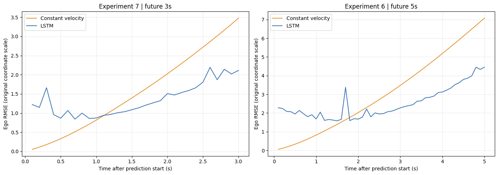
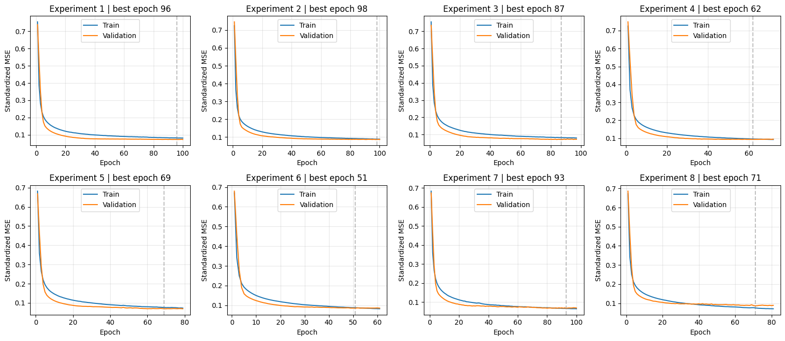
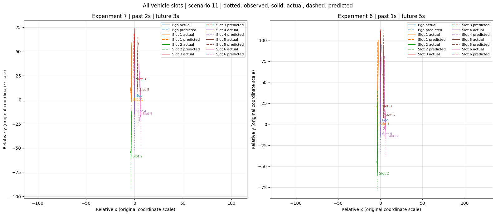

# LSTM 기반 차량 주행궤적 예측

**2026학년도 2학기 교통물류데이터과학 및 인공지능 · 5조 · 중간발표 완료**

차량의 과거 위치로 미래 3초·5초의 주행궤적을 예측했다. LSTM 유닛 수와 관측 길이를 바꾼 8개 조건을 비교하고, 일정속도 예측과의 차이 및 오차가 커지는 상황을 분석했다.

정채환이 기획, 데이터 점검·전처리, 모델 실험, 평가·추가 분석과 보고서 작성을 수행했다.

## 결과

같은 평가 사례에서 선택한 LSTM의 구간 전체 Ego RMSE는 일정속도 기준보다 **3초 예측에서 24.72%, 5초 예측에서 29.26% 낮았다.** 가까운 미래의 일부 시점에서는 일정속도 예측이 더 정확했다.

| 예측 구간 | 일정속도 RMSE | LSTM RMSE | 감소율 |
|---|---:|---:|---:|
| 3초 | 1.8712 | 1.4088 | 24.72% |
| 5초 | 3.7144 | 2.6274 | 29.26% |

위 지표는 Ego의 원래 좌표 성분 오차다. 아래 8개 실험의 정규화 지표와 구분한다. 학습·평가 사이 동일 차량·프레임 중첩이 있어 독립 주행 장면의 성능을 나타내지는 않는다.

## 데이터와 실험

[가로형 워크플로우](https://lucid.app/lucidchart/1d8a4a48-4ec7-4717-a78c-4046ce59b5af/edit)

수업에서 제공한 NGSIM US-101 전처리 자료 **10,000개 시나리오**를 사용했다. 시나리오마다 Ego 1대와 주변 차량 최대 6대의 7초 관측이 있다. 모델 입력은 차량 7대의 x·y 좌표, 시점당 14개 값이다.

유닛 64·128 × 과거 1·2초 × 미래 3·5초의 8개 조건을 같은 분할에서 비교했다. 학습 6,800개, 검증 1,200개, 평가 2,000개이며 정규화 기준은 학습 자료에서만 계산했다.

같은 시간 조건에서는 128유닛의 정규화 RMSE가 낮았다. 과거 관측을 1초에서 2초로 늘리는 효과는 일정하지 않았다. 검증 기준으로 3초 예측은 128유닛·과거 2초, 5초 예측은 128유닛·과거 1초 모델을 선택했다.

## 궤적과 오차 분석

예측 시점이 멀어질수록 오차가 증가하는 경향을 확인했다. 차로 ID 변화 집단은 유지 집단보다 8개 모델 모두에서 Ego RMSE가 높았다. 정지 상황에서 실제보다 전진하는 종방향 편향도 관찰했다.

이 그림은 관측 차량 슬롯 수를 기준으로 고른 설명용 사례다. 전체 평가의 대표 정확도를 뜻하지 않는다. [시간·차로 상태별 오차](reports/technical_report.md#오차-분석)도 함께 확인할 수 있다.

## 자료

- [분석 노트북](notebooks/01_lstm_trajectory_analysis.ipynb)
- [별도 작성한 분석 보고서 PDF · 19쪽](reports/midterm_analysis_report.pdf)
- [기술보고서 요약](reports/technical_report.md)
- [8개 실험 결과표](results/model_comparison.csv)
- [실행 안내](docs/reproduction.md)

기술: Python · TensorFlow/Keras · LSTM · NumPy · pandas · scikit-learn · Matplotlib

## 현재 범위와 다음 단계

기본 LSTM 실험과 중간발표까지 진행했다. 과제②의 NGSIM·CitySim 원자료 분석과 Convolutional Social Pooling LSTM은 후속 과제다.

현재 평가는 고정 무작위 시나리오 분할·단일 학습 기준이다. 평가 시나리오의 94.30%에는 학습에도 등장한 Ego 차량이 포함돼 있고, 같은 차량·프레임 조합도 중첩된다. 기본 7대 지표는 부재 차량의 0 채움값을 포함한다. 차량·시간이 분리된 평가와 존재 차량만의 평가가 필요하다.

원본 데이터와 학습 모델은 포함하지 않았다. 노트북의 코드와 저장된 결과를 정리했으며 이번 업로드 과정에서 재학습하지 않았다. PPT와 발표 슬라이드 PDF는 제외하고 분석 그림과 별도 보고서만 포함했다.
