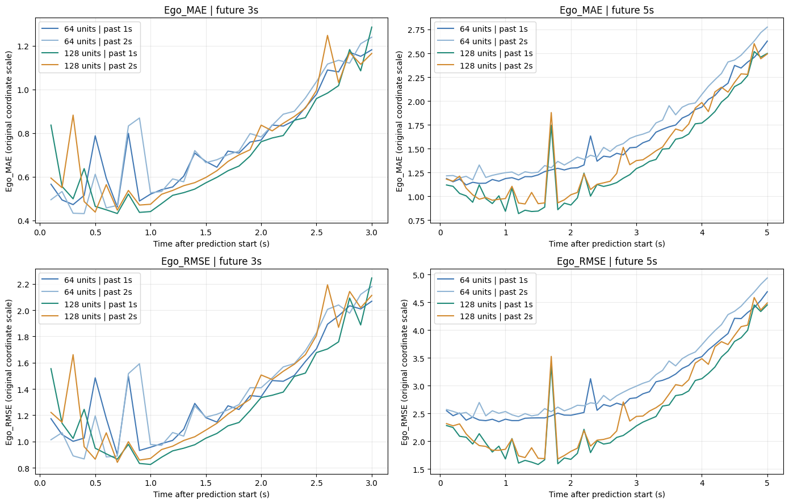
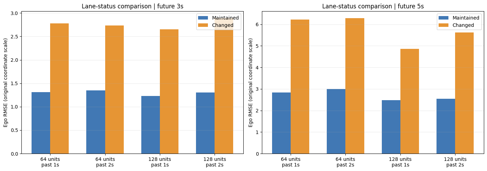

# 차량 궤적 예측 분석 요약

## 연구 목적

과거 궤적으로 미래 x·y 위치를 예측하고 LSTM의 유닛 수, 과거 관측 길이, 미래 예측 길이에 따른 오차를 비교했다. 평균 성능뿐 아니라 예측 시점·차로 상태·정지 상황별 실패를 확인하고 일정속도 기준과 비교했다. 중간발표까지 수행한 분석이다.

## 데이터와 입력

수업 제공 파일 `US101_0750_0805_scene(sample).pickle`의 배열은 `(10000, 7, 71, 14)`다. 10,000개 시나리오, 차량 슬롯 7개, 0.1초 간격 관측점 71개, 원본 특성 14개를 뜻한다. 고유 Ego 차량은 1,616대이며 차량 수와 시나리오 수는 다르다.

모델은 원본 특성 전체 대신 차량 7대의 x·y를 시점당 14개 값으로 사용한다. 주변 차량 부재의 NaN은 모델 배열에서 0으로 채웠다. 관측 마지막 시점의 Ego 위치를 공통 원점으로 빼 상대좌표를 만들었다.

관측 종료 인덱스는 20으로 고정했다. 과거 1초는 10~20의 11개, 2초는 0~20의 21개 관측점이다. 미래 3초는 21~50, 5초는 21~70을 예측한다. 현재 7초 시나리오에서 같은 시작점으로 비교 가능한 조건이다.

## 모델과 평가

LSTM → Dense → Reshape → Batch Normalization → ReLU → Dropout(0.01) → TimeDistributed Dense 구조다. 미래 좌표 묶음을 한 번에 출력하며 재귀적으로 예측값을 입력에 넣지 않는다.

학습/검증/평가는 6,800/1,200/2,000개로 고정했다. 입력과 정답의 StandardScaler를 학습 자료에만 적합했다. Adam 0.001, 배치 64, 최대 100 epoch, patience 10의 조기 종료를 사용했다. 유닛 64·128 외에 광범위한 하이퍼파라미터 탐색은 하지 않았다.

| 실험 | 유닛 | 과거(초) | 미래(초) | 정규화 MAE | 정규화 RMSE |
|---|---:|---:|---:|---:|---:|
| 1 | 64 | 1 | 3 | 0.1585 | 0.2655 |
| 2 | 64 | 1 | 5 | 0.1839 | 0.3001 |
| 3 | 64 | 2 | 3 | 0.1593 | 0.2663 |
| 4 | 64 | 2 | 5 | 0.1889 | 0.3021 |
| 5 | 128 | 1 | 3 | 0.1547 | 0.2612 |
| 6 | 128 | 1 | 5 | 0.1813 | 0.2923 |
| 7 | 128 | 2 | 3 | 0.1544 | 0.2608 |
| 8 | 128 | 2 | 5 | 0.1842 | 0.2963 |

표는 전체 7대 좌표 성분과 부재 차량 채움값을 포함한 무단위 지표다. ADE/FDE와 다르며 3초·5초의 정규화 기준도 같지 않다. 단일 점수를 물리적 거리로 읽지 않는다.

검증 결과로 실험 7과 6을 선택했다. 같은 시간 조건에서 128유닛은 오차가 낮았으나 과거 길이 증가에는 일관된 이점이 없었다. 다른 seed로 반복 학습한 결론은 아니다.

## 오차 분석

예측 후반으로 갈수록 원래 좌표 Ego 오차가 커졌다. 차로 ID 유지 1,914개·변화 86개로 구분했을 때 변화 집단의 RMSE가 모든 실험에서 높았다. 차로 상태는 전체 7초의 ID 변화로 정의한 사후 분류다.

정지·감속 상황 역시 미래 실제값을 이용한 오차 진단이며 예측 시점에 해당 상태를 미리 분류한 결과가 아니다. 정지 상황에서 종방향 과대예측을 확인했으나 정지 집단의 평균 오차가 항상 가장 크지는 않았다.

최근 관측 1초 변위로 속도를 추정한 일정속도 모델과 같은 평가 사례·Ego 좌표·미래 구간을 비교했다. RMSE는 3초에서 1.8712→1.4088, 5초에서 3.7144→2.6274였다. 저장된 반올림 전 결과의 감소율은 24.7151%·29.2641%다. 가까운 미래 일부 시점에서는 일정속도 모델이 더 정확했다.

## 분할 중첩과 한계

학습·평가의 시나리오 인덱스 중복은 없었지만 공통 Ego 차량 930대, 공통 Ego 차량·프레임 조합 78,581개가 확인됐다. 평가 시나리오의 94.30%가 학습에 등장한 Ego 차량을 포함한다. 이 수치는 시나리오 전체 71개 시점 기준으로 학습 정답·평가 정답의 직접 중첩량과는 다르다.

결과는 같은 교통 자료의 고정 분할 내 비교다. 신규 도로·미관측 차량 일반화, 사고 감소와 자율주행 안전 효과를 검증하지 않았다. 차량 단위 부트스트랩은 사후 탐색적 보조 분석이며 차량 간 의존성과 학습·평가 중첩이 남는다.

## 후속 과제

차량·프레임·시간 중첩을 배제한 분할에서 재학습하고, 부재 슬롯을 제외한 오차와 반복 seed의 변동을 확인할 필요가 있다. 과제②의 원자료 구축과 Social Pooling LSTM은 이번 완료 범위에 포함하지 않았다.

[별도 작성한 상세 보고서](midterm_analysis_report.pdf)에는 전체 EDA, 학습곡선, 궤적, 잔차 진단과 참고문헌을 수록했다.
